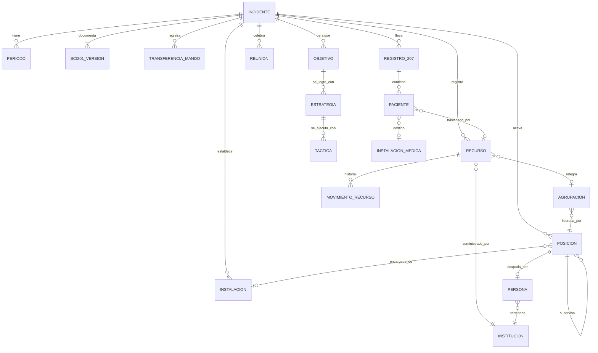

# 08 – Propuesta de diseño: Sistema de Gestión SCI (fase básica)

> **Aviso:** este archivo es una **propuesta de diseño derivada** del manual, no transcripción. Cada regla indica entre corchetes la fuente en el manual cuando aplica.

## 1. Alcance del MVP (fase básica)

| Módulo | Cubre | Formularios |
|---|---|---|
| M1. Incidentes | Alta del incidente, nombre, tipo, ubicación, estado, periodos | — |
| M2. Mando y estructura | CI/CU, transferencia de mando, activación modular de posiciones, organigrama versionado | SCI-201 p.4 |
| M3. Resumen del Incidente | Evaluación inicial, objetivos, PC, E, rutas, mensaje de seguridad, mapa, bitácora de acciones | SCI-201 |
| M4. Recursos | Solicitud, registro único, estados, asignación, liberación, desmovilización, tablero tipo tarjetas T | SCI-211 |
| M5. Pacientes | Registro en ACV/UM, triage, traslados | SCI-207 |
| M6. Instalaciones y mapa | PC, E, ACV, B, C, H, H1 con símbolos SCI | SCI-201 p.2 |
| M7. Reuniones | Reunión de Evaluación (decisión: nuevo PO o cierre) | 201/207/211 |
| M8. Documentación y cierre | Entrega de formularios a Documentación, Informe Final, archivo | Todos |
| (Fase 2) | PAI escrito, Reunión Táctica y de Planificación, briefings | 202, 204, 205, 206, 214, 215 |

## 2. Modelo de entidades



### Entidades principales

| Entidad | Atributos clave |
|---|---|
| **Incidente** | id, nombre [201-1], clase (incidente/evento/operativo), tipo, lugar + coordenadas [201-3], fecha-hora de inicio, estado, jurisdicciones |
| **Periodo** | id, tipo (INICIAL / OPERACIONAL), número, inicio, fin, estado. Inicial: 1–4 h; Operacional: 12–24 h [Periodos] |
| **SCI201_Version** | ver `04_formulario_SCI-201.md` |
| **Objetivo / Estrategia / Táctica** | texto, periodo, estado (pendiente/en curso/logrado), responsable; táctica con qué/dónde/cuándo [Tarjeta de Campo] |
| **Posición** | cargo (catálogo), nivel (Staff/Sección/Rama/División/Grupo/Unidad/Instalación/EI/FT/Recurso simple), superior_id, persona_id, activa_desde, activa_hasta, identificador radial, nombre geográfico/funcional (ej. "División A", "Grupo Evacuación") |
| **Persona** | nombre, institución, documentos y vencimientos, acreditaciones SCI, contacto, contacto familiar [Preparación/Activación] |
| **Institución** | nombre, representante en el PC, contacto [Representante Institucional] |
| **Instalación** | tipo (PC/E/ACV/B/C/H/H1), nombre, coordenadas, encargado (posición), estado |
| **Recurso** | ver `06_formulario_SCI-211.md` |
| **Agrupación** | tipo (EQUIPO_INTERVENCION / FUERZA_TAREA), líder, comunicaciones, asignación |
| **Registro207 / Paciente** | ver `05_formulario_SCI-207.md` |
| **TransferenciaMando** | fecha-hora, entrega, recibe, sci201_version_id, checklist de transferencia completado |
| **Reunión** | tipo, coordina, asistentes, formularios presentados, decisión/producto, fecha-hora |

## 3. Catálogos (terminología común)

- **Cargos** con sigla, nivel, título (Oficial, Jefe, Coordinador, Supervisor, Líder, Encargado, Responsable) y superior por defecto → lista completa en `03_estructura_y_roles.md`.
- **Instalaciones**: PC, E, ACV, B, C, H, H1.
- **Estados de recurso**: SOLICITADO, EN_RUTA, DISPONIBLE, ASIGNADO, FUERA_DE_SERVICIO, DESMOVILIZADO (+ motivo FDS: mecánico, descubierta/sin personal, descanso, otro).
- **Clases y tipos de recursos**: configurables por país/institución (el manual remite a "manuales de tipificación de recursos" municipales, departamentales/provinciales y nacionales).
- **Triage**: ROJO, AMARILLO, VERDE, NEGRO.
- **Medios de traslado**: AMBULANCIA, AÉREO, EMBARCACIÓN, OTRO.
- **Áreas del ACV**: CLASIFICACIÓN, ESTABILIZACIÓN, TRANSPORTE, MORGUE.
- **Colores de tarjetas T** por tipo de recurso (Anexo D).

## 4. Máquinas de estado

### 4.1 Incidente
```
NOTIFICADO ─► PERIODO_INICIAL ─► EN_EVALUACION ─┬─► PERIODO_OPERACIONAL(n) ─► EN_EVALUACION ─┐
                                               │                    ▲                       │
                                               │                    └───────────────────────┤
                                               └─────────────────────────────► DESMOVILIZANDO ─► CERRADO
```
- `PERIODO_INICIAL` se crea automáticamente al asumir el mando [siempre existe un periodo inicial].
- Pasar a `EN_EVALUACION` requiere SCI-201, 207 y 211 actualizados [Reunión de Evaluación].
- La decisión de ir a un PO la toma **solo el CI/CU** [Reunión de Evaluación].
- Pasar a `PERIODO_OPERACIONAL` (fase 2) exigirá PAI SCI-202 aprobado por el CI.
- `DESMOVILIZANDO` requiere Plan de Desmovilización aprobado por el CI/CU [CI, LUDES].
- `CERRADO` requiere: todos los recursos DESMOVILIZADO, formularios entregados a Documentación, Informe Final [CI, LUDOC].

### 4.2 Recurso → ver `06_formulario_SCI-211.md` §4.

### 4.3 Posición
```
NO_ACTIVADA ─► ACTIVADA (persona asignada, briefing recibido) ─► DESMOVILIZADA
```
- Mientras una función no esté activada, la ejerce el superior (en última instancia el CI) [activación modular].
- Activar/desactivar notifica a la Unidad de Recursos y crea snapshot del organigrama (SCI-201 p.4) [JSP, LUREC].

### 4.4 Paciente
```
REGISTRADO (Clasificación) ─► ESTABILIZACIÓN ─► TRANSPORTE ─► TRASLADADO
            │                                                   
            ├─► ALTA_EN_SITIO
            └─► MORGUE (Negro)
```

## 5. Flujos principales

### F1. Primer respondedor / apertura del incidente
1. Crear incidente con **nombre** e informar arribo a la central [Paso 1].
2. Asumir el mando: CI = usuario actual, identificación radial, ubicación del PC (con checklist de condiciones del PC) [Paso 2].
3. Evaluación inicial guiada por las 9 preguntas [Paso 3] → campos 3 y 4 del 201.
4. Perímetro de seguridad (dibujo en mapa + checklist de factores) [Paso 4].
5. Objetivos (validador SMART: específico, observable, alcanzable, evaluable) [Paso 5].
6. Estrategias y tácticas (qué/dónde/cuándo) [Paso 6] → bitácora del 201-13.
7. Solicitar recursos (crea filas SOLICITADO en el 211) y definir instalaciones (E, ACV…) [Paso 7].
8. Generar paquete de transferencia de mando [Paso 8].

### F2. Registro y control de recursos
1. Registrador en E/B/H/PC escanea o busca solicitud → registra arribo (registro único).
2. Recurso queda DISPONIBLE en el E.
3. CI/JSO/Supervisor asigna → ASIGNADO a división/grupo/FT/EI.
4. Cambios de estado reportados por la autoridad que los aprueba, vía Comunicaciones → Unidad de Recursos [Anexo H].
5. Liberación: reasignación activa, regreso a E (disponible) o liberación a B/C [Anexo J].
6. Desmovilización por CI/JSO/autorizado, con hora efectiva.

### F3. Atención de pacientes
1. EACV o LUMED abre un Registro 207 para su instalación.
2. Registro de paciente con triage y hora.
3. Traslado: destino (de la lista de instalaciones médicas del 206) + medio (vinculado a recurso del 211).
4. Resumen automático por color/destino para el Informe de Situación.

### F4. Transferencia de mando
1. CI saliente genera SCI-201 actualizado.
2. Checklist: estado del incidente (qué pasó, qué se logró, qué falta, qué se necesita), seguridad, objetivos/estrategias/tácticas, organización, asignación de recursos, recursos en camino, instalaciones, comunicaciones, probable evolución.
3. Transferencia **en persona** confirmada por ambos (registro con hora).
4. Se notifica a toda la estructura el cambio de CI (y a la central).

### F5. Reunión de Evaluación
1. Convoca el CI/CU; asistentes JSO, JSP, OFIP (los que estén activados).
2. El sistema genera el **Informe de Situación** con: SCI-201 vigente (situación, objetivos y su avance, acciones), SCI-207 (totales de pacientes por clasificación y destino), SCI-211 (recursos por estado, pendientes de arribo, total de personas).
3. Registrar logros, pendientes y necesidades.
4. Decisión del CI: **nuevo periodo operacional** (define duración 12–24 h según factores) o **desmovilización/cierre**.

### F6. Desmovilización y cierre
1. LUDES (o CI/JSP) revisa el 211 para dimensionar el esfuerzo.
2. Plan de Desmovilización: información general, responsabilidades, prioridades de salida, procedimientos de salida, documentación → aprobación del CI.
3. Cada posición: recursos inventariados y relevados, formularios entregados a Documentación, informe oral breve (positivos y mejoras).
4. LUDOC verifica integridad y exactitud; corrige omisiones con los responsables.
5. CI prepara el Informe Final (adjunta SCI-201) y cierra el incidente.

## 6. Matriz de permisos sugerida (fase básica)

| Acción | CI/CU | OFS | OFIP | OFE | JSO | SD/SG/LEI/LFT | EAE | EACV | JSP | LUREC | Registrador | LUMED | LUDOC | JSAF |
|---|---|---|---|---|---|---|---|---|---|---|---|---|---|---|
| Crear incidente / asumir mando | ✔ | | | | | | | | | | | | | |
| Editar SCI-201 | ✔ (o designado) | sugiere mensaje seguridad | | | sugiere tácticas | | | | ✔ (actualización) | | | | | |
| Activar posiciones | ✔ | | | | ✔ (su sección) | | | | ✔ (su sección) | | | | | |
| Solicitar recurso | ✔ | | | | ✔ | solicita vía superior | solicita | solicita | | | | | | |
| Registrar arribo (211) | | | | | | | ✔ | | | ✔ | ✔ | | | |
| Asignar recurso | ✔ | | | | ✔ | ✔ (dentro de su ámbito) | | | | | | | | |
| Cambiar estado recurso | ✔ | detener acción insegura | | | ✔ | ✔ (sus recursos) | ✔ (en E) | | | ✔ (procesar) | ✔ | | | |
| Desmovilizar recurso | ✔ | | | | ✔ | ✔ (si autorizado) | | | | | | | | |
| Registrar pacientes (207) | | | | | | | | ✔ | | | | ✔ | | |
| Ver datos de pacientes | ✔ | ✔ | resumen | | ✔ | | | ✔ | ✔ | | | ✔ | ✔ | |
| Aprobar comunicado de prensa | ✔ | | prepara | | | | | | | | | | | |
| Convocar Reunión de Evaluación / decidir PO | ✔ | | | | | | | | | | | | | |
| Recibir/verificar documentación | | | | | | | | | | | | | ✔ | |
| Ver lista maestra de recursos | ✔ | ✔ | | ✔ | ✔ | parcial | ✔ | | ✔ | ✔ | ✔ | | ✔ | ✔ |

Regla general: **un usuario puede ocupar varias posiciones** (el CI ocupa todas las no activadas); los permisos se calculan por posiciones activas, no por usuario.

## 7. Validaciones clave (checklist de implementación)

- [ ] Exactamente un CI activo o un CU (≥2 personas de distintas instituciones/jurisdicciones) por incidente.
- [ ] Unidad de mando: cada posición tiene un único superior.
- [ ] Alcance de control configurable; alerta cuando un supervisor supera el límite (sugerir activar Rama/División/Grupo).
- [ ] Periodo inicial: alerta al acercarse a 4 h sin Reunión de Evaluación.
- [ ] Periodo operacional: duración entre 12 y 24 h.
- [ ] Registro único de recurso por institución + matrícula.
- [ ] Equipo de Intervención: misma clase y tipo; FT: mezcla permitida; ambos con líder y comunicaciones.
- [ ] Toda fecha-hora en 24 h; toda acción con usuario y posición que la ejecuta (trazabilidad / rendición de cuentas).
- [ ] Bitácoras (201-13, 211-12, 214) solo de agregado.
- [ ] No cerrar periodo/incidente con recursos sin estado actualizado o formularios sin entregar.
- [ ] Información externa (comunicados, reportes) solo con aprobación del CI.
- [ ] Datos de pacientes con acceso restringido.
- [ ] Funcionamiento **offline** con sincronización posterior (la escena suele tener conectividad limitada) — recomendación técnica, no del manual.
- [ ] Exportación de cada formulario en su formato oficial (PDF imprimible) para Documentación e Informe Final.

## 8. Tableros sugeridos (equivalentes digitales de las pizarras del PC)

| Tablero | Responsable en el manual | Contenido |
|---|---|---|
| Situación | LUSIT | Situación actual, anuncios importantes, mapa de situación (desde 201-12), predicciones |
| Recursos | LUREC | Lista maestra; tarjetas T por color; columnas por estado / ubicación; recursos en ruta con ETA |
| Organización | LUREC | Organigrama actual (201-14) con nombres y contactos |
| Pacientes | EACV / LUMED | Totales por color, por destino, traslados en curso |
| Objetivos | CI / JSP | Objetivos del periodo, estrategias, tácticas y avance |

## 9. Puntos abiertos / inconsistencias del manual a decidir

1. **Estados del SCI-211:** instrucciones ("Disponible, No disponible, Fuera de servicio") vs. columnas impresas ("Disponible, No disponible, Asignado a") vs. Anexo H ("Asignados, Disponibles, Fuera de servicio"). Propuesta: enum único (§3) + campo "asignado a".
2. **Campo 4 "Tipo" del SCI-211:** el manual repite la instrucción de "Clase". Propuesta: Tipo = nivel de capacidad dentro de la clase, según el manual nacional de tipificación.
3. **Alcance de control:** el manual no da número. Propuesta: parámetro (por defecto 5, rango 3–7).
4. **Sexo en SCI-207:** solo M/F en el manual. Evaluar agregar "no determinado" para pacientes inconscientes.
5. **Pacientes no identificados:** el manual no lo contempla; se sugiere identificador temporal (p.ej. tarjeta de triage).
6. **Rama/División máximas:** Anexo A indica "Ramas (hasta 5)" y "Divisiones/Grupos (hasta 25)"; puede usarse como límite de validación.
7. **Instalación médica vs. ACV:** en la fase básica puede no existir SCI-206; el catálogo de hospitales debe poder crearse ad hoc desde el 207.
