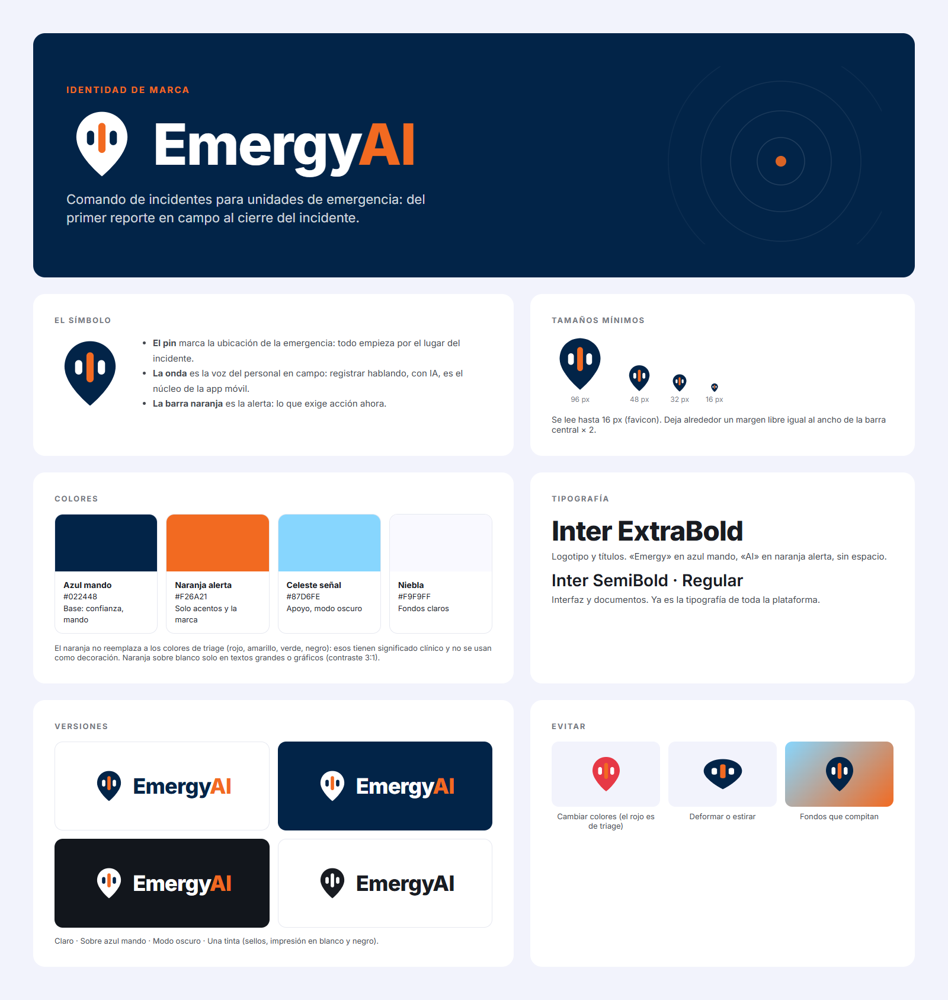

# Marca EmergyAI

EmergyAI es el nombre del proyecto original, el que se usa en presentaciones. Cada despliegue para una unidad de emergencia sigue usando esta marca y agrega el nombre y el logo de esa unidad (ver "Marca por organización").

## Símbolo

Un pin de ubicación con una onda de voz adentro:

- **El pin** es la ubicación de la emergencia. Todo empieza por el lugar del incidente.
- **La onda** es la voz del personal en campo. El registro por voz con IA es el núcleo de la app móvil (etapa 2).
- **La barra naranja** es la alerta, lo que exige acción ahora.

Se lee bien hasta 16 px, así que sirve también como favicon. Alrededor hay que dejar un margen libre igual a dos veces el ancho de la barra central.

## Colores

| Nombre | Hex | Uso |
|---|---|---|
| Azul mando | `#022448` | Base de la marca. Es el mismo primario de la plataforma. |
| Naranja alerta | `#F26A21` | Solo para el "AI" del logotipo, la barra central y acentos. Sobre blanco, úsalo solo en textos grandes o gráficos (contraste 3:1). |
| Celeste señal | `#87D6FE` | Color de apoyo, sobre todo en modo oscuro. |
| Niebla | `#F9F9FF` | Fondos claros. |

El naranja **no** reemplaza a los colores de triage (rojo, amarillo, verde y negro). Esos colores tienen significado clínico y no se usan como decoración.

## Tipografía

- **Inter ExtraBold** para el logotipo y los títulos. Se escribe «Emergy» en azul mando y «AI» en naranja alerta, sin espacio entre ambos.
- **Inter SemiBold y Regular** para la interfaz y los documentos. Ya es la tipografía de toda la plataforma.

## Archivos

| Archivo | Para qué sirve |
|---|---|
| `emergyai-logo-horizontal.png` / `-inverse.png` | Presentaciones y documentos. La versión inversa va sobre fondo azul u oscuro. |
| `emergyai-logo-vertical.png` / `-inverse.png` | Portadas y piezas cuadradas. |
| `emergyai-mark.svg` / `-inverse.svg` | El símbolo en vector, para escalarlo sin perder calidad. |
| `emergyai-mark-512.png` / `-inverse-512.png` | Ícono de app y avatar en redes. |
| `emergyai-touch-icon.png`, `favicon.ico` | Ícono del navegador y de la pantalla de inicio del celular. |
| `emergyai-conceptos.png` | Las cuatro variantes evaluadas. Se eligió la A. |

Todos los PNG tienen fondo transparente, salvo el touch icon.

En la plataforma, el símbolo es el componente `app-brand-logo` (`front-sci/src/app/shared/components/brand-logo`). Se adapta solo al modo oscuro, y con `inverse` se usa sobre fondo azul mando.

## Evitar

- Cambiar los colores, sobre todo usar rojo, que es un color de triage.
- Deformar o estirar el símbolo.
- Ponerlo sobre fondos que compitan con él, como degradados o fotos sin velo.

## Marca por organización (propuesta, pendiente de confirmar)

Cada despliegue publica su nombre y su logo desde el **backend**: el endpoint `GET /api/config/public`, que ya existe, se amplía con estos datos. El front los muestra junto a EmergyAI, por ejemplo «EmergyAI · Bomberos Voluntarios X».
